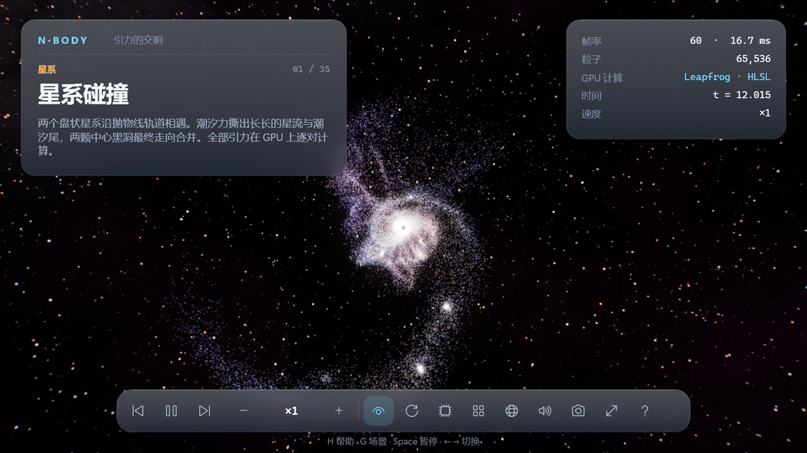
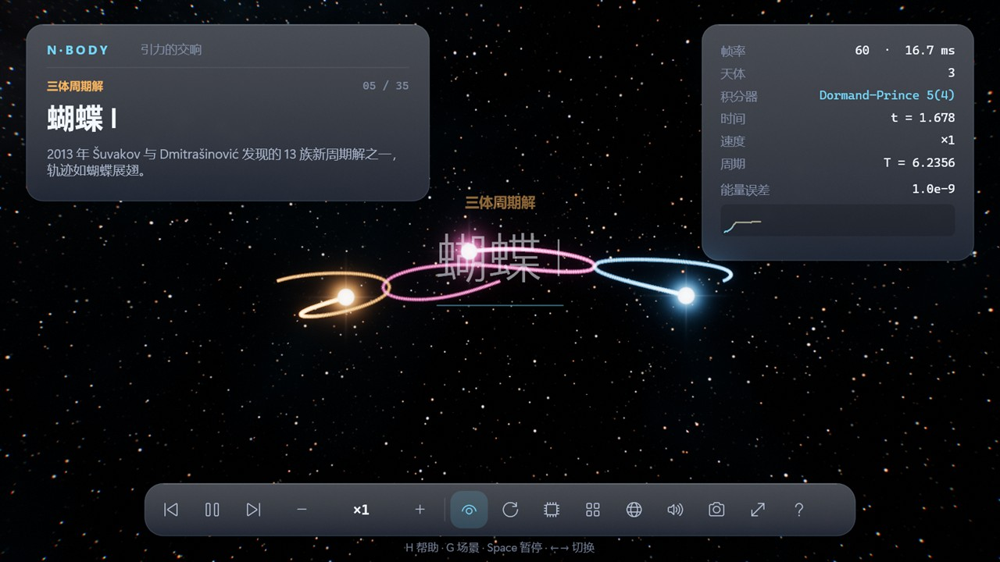
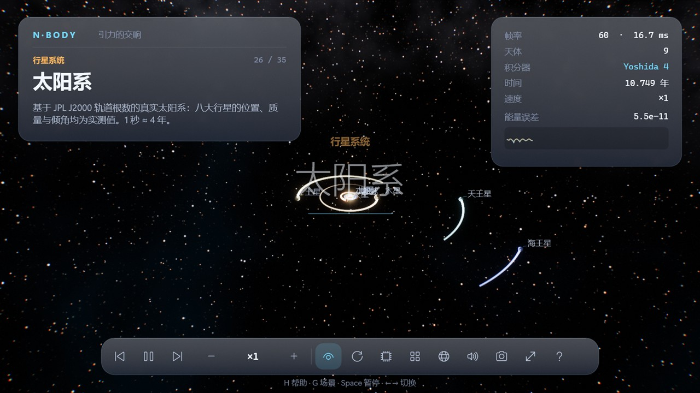
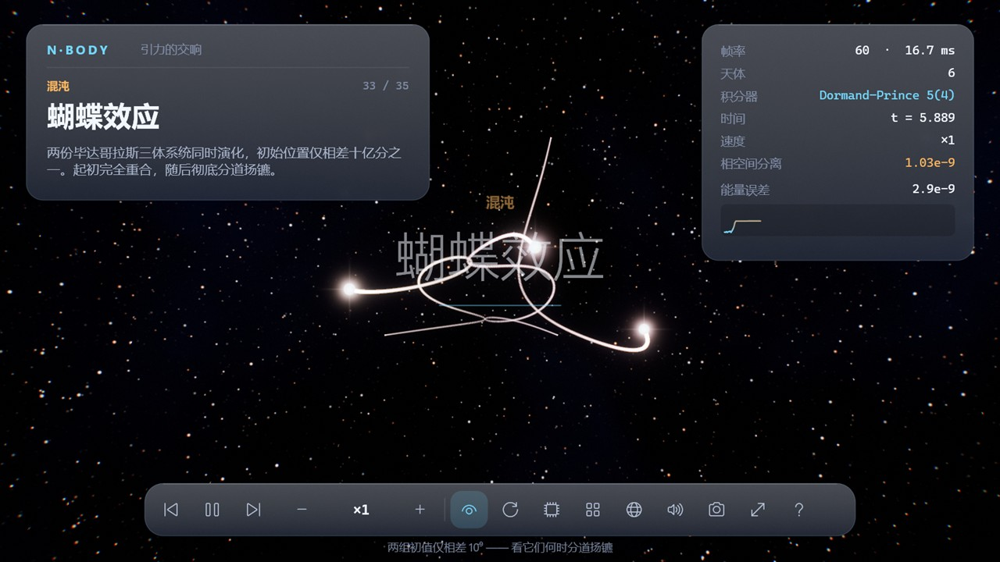
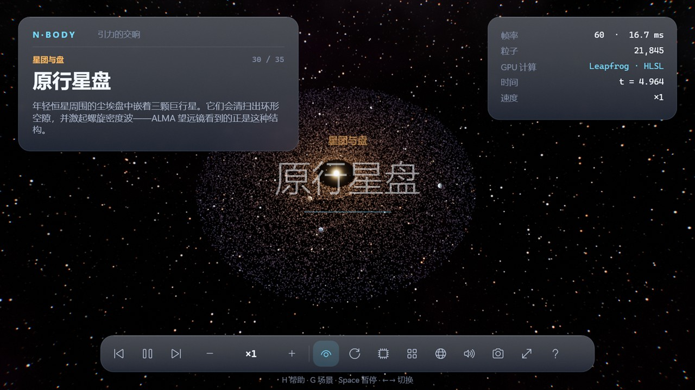

# N·Body — A Gravitational Symphony [](http://qm.qq.com/cgi-bin/qm/qr?_wv=1027&k=mma4msRKd372Z6dWpmBp4JZ9RL4Jrf8X&authKey=gccTx0h0RaH5b8B8jtuPJocU7MgFRUznqbV%2FLgsKdsK8RqZE%2BOhnETQ7nYVTp1W0&noverify=0&group_code=495782587)

[中文](README.md) | **English**

A real-time 3D gravity simulator for Windows, built on Direct3D 11 compute shaders, HDR bloom and a frosted-glass HUD.



| | |
|---|---|
|  |  |
|  |  |

## Features

- **35 scenarios in 7 categories**
  - **Galaxies**: galaxy collision, Milky Way × Andromeda, a self-gravitating spiral. Up to 65k particles, computed with O(N²) direct summation on the GPU (tiled HLSL compute shader, leapfrog). Dark-matter halos and dynamical friction let the galaxies actually merge.
  - **Periodic three-body**: Figure-8, the Šuvakov–Dmitrašinović family (butterflies, moths, dragonfly, yin-yang, bumblebee, yarn…), Broucke, Hénon, Lagrange.
  - **Choreographies**: rigidly rotating rings of 4, 6 and 12 bodies, and a moonlet ring.
  - **Planetary systems**: the real Solar System from JPL J2000 elements (G = 4π², AU, years), the inner Solar System, and a circumbinary "Tatooine" system.
  - **Clusters & disks**: Plummer globular cluster, cold collapse, a protoplanetary disk with gap-carving planets.
  - **Chaos**: the butterfly effect (two Pythagorean three-body systems whose initial conditions differ by 10⁻⁹) and the Pythagorean problem itself.
  - **Sandbox**: Shift + drag to launch new bodies; colliding bodies merge.
- **Physics core** (`Sdcb.NBody`, platform-independent, AOT-compatible): Structure-of-Arrays layout, SIMD plus parallel force summation, Plummer softening, and four integrators (Leapfrog, Yoshida 4, RK4, adaptive Dormand–Prince 5(4)). Energy, momentum and angular momentum are tracked live, with an energy-drift chart in the HUD.
- **Visuals**: procedural starfield and nebula, HDR rendering, physically-inspired bloom, ACES tonemapping, fading GPU trails, stars with corona and diffraction spikes, lit planets with atmospheres, black holes with Doppler-beamed accretion disks.
- **Experience**: launches into a cinematic attract mode (auto camera, scenario carousel); bilingual zh/en UI switchable at runtime; procedurally synthesized ambient soundtrack (no audio assets); F12 screenshots; automatic quality tiers per GPU.
- **Engineering**: native Win32 window, no WinForms; Native AOT single-file exe (~3 MB); xUnit tests; GitHub Actions CI and releases.

## Controls

| Input | Action |
|---|---|
| Left drag | Orbit camera |
| Right or middle drag | Pan |
| Wheel | Zoom |
| Double-click a body | Follow |
| `Space` | Pause |
| `←` `→` | Previous / next scenario |
| `↑` `↓` | Faster / slower |
| `G` | Scenario gallery |
| `I` | Cycle integrator |
| `T` | Toggle trails |
| `R` | Reset |
| `F` | Re-frame camera |
| `Tab` | Hide HUD |
| `L` | 中文 / English |
| `M` | Mute |
| `F11` | Fullscreen |
| `F12` | Screenshot (saved to Pictures\N-Body) |
| `H` | Help |
| `Esc` | Quit |

## Build

Requirements: Windows 10+, .NET 10 SDK, and a D3D11 GPU (feature level 11.0).

```powershell
dotnet run --project Sdcb.NBody.App                 # run (fullscreen)
dotnet run --project Sdcb.NBody.App -- --windowed   # run in a window
dotnet test Sdcb.NBody.Tests                        # unit tests
dotnet publish Sdcb.NBody.App -c Release -r win-x64 # Native AOT single exe
```

Command-line options:

```text
--windowed                start in a window
--scenario <id>           start directly in a scenario (e.g. galaxy-collision, figure-8)
--capture <file.png>      render to a PNG after --capture-at seconds, then exit
--check-shaders           compile every shader and report errors
```

Set the environment variable `NBODY_QUALITY` to `ultra`, `high`, `medium` or `low` to override the automatic quality tier.

## Layout

```text
Sdcb.NBody/          physics core: BodySet, ForceModel, integrators, Simulation, Scenarios/
Sdcb.NBody.App/      renderer: Win32 window, D3D11 device, HLSL shaders, HUD, audio
Sdcb.NBody.Tests/    xUnit tests: conservation laws, periodic-orbit regression, scenario sanity
```

## WeChat group


If the WeChat QR code has expired, join the QQ group [.NET骚操作 495782587](http://qm.qq.com/cgi-bin/qm/qr?_wv=1027&k=mma4msRKd372Z6dWpmBp4JZ9RL4Jrf8X&authKey=gccTx0h0RaH5b8B8jtuPJocU7MgFRUznqbV%2FLgsKdsK8RqZE%2BOhnETQ7nYVTp1W0&noverify=0&group_code=495782587).

## License

[MIT](LICENSE.txt)
